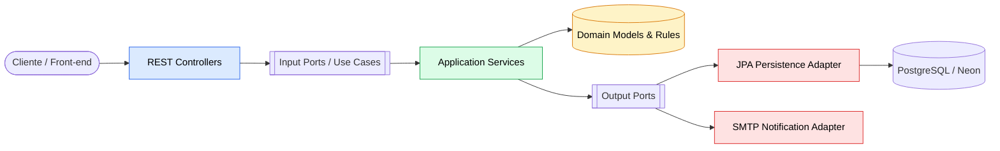

<div align="center">

# 🎬 GitCine — Backend API

**Plataforma de catálogo e avaliação de filmes construída com Arquitetura Hexagonal, Java 25 e Spring Boot 4.**

[](https://openjdk.org/)
[](https://spring.io/projects/spring-boot)
[](https://neon.tech/)
[](https://jwt.io/)
[](#%EF%B8%8F-arquitetura-do-projeto)

</div>

---

## 📋 Sobre o Projeto

O **GitCine** é a evolução arquitetural do projeto legado DSMovie. O sistema foi completamente reestruturado para **Arquitetura Hexagonal (Ports & Adapters)**, separando regras de negócio puras da camada web e da persistência, além de introduzir autenticação *stateless* via **JWT**, controle de acesso baseado em papéis (**RBAC**), recálculo transacional de médias com *lock pessimista* e envio assíncrono de sugestões de filmes por e-mail.

### ✨ Principais Funcionalidades

- 🔐 **Autenticação & Segurança:** Cadastro e login com criptografia **BCrypt**, tokens **JWT** assinados com expiração de 2 horas e prevenção contra IDOR (`userId` extraído exclusivamente do token).
- 🛡️ **Controle de Acesso (RBAC):** Segregação de permissões entre visitantes públicos, usuários autenticados (`ROLE_USER`) e administradores (`ROLE_ADMIN`).
- ⭐ **Sistema de Avaliações:** Notas de `1.0` a `5.0` sem duplicidade por usuário/filme (chave composta) e recálculo consistente de média (`AVG`) e contagem (`COUNT`) protegido por *pessimistic write lock*.
- 📩 **Sugestão de Filmes:** Usuários autenticados podem propor novos títulos ao catálogo com notificação assíncrona via SMTP.
- 🎞️ **Gestão Administrativa:** Endpoint exclusivo para administradores adicionarem novos filmes com validação de título duplicado.

---

## 🏗️ Arquitetura do Projeto

O código segue o isolamento de dependências da **Arquitetura Hexagonal**, onde o núcleo de domínio não depende de frameworks externos:



### 📂 Estrutura de Pacotes (`com.dsmovie`)

```text
src/main/java/com/dsmovie
├── domain/                  # Núcleo puro (sem dependências de Spring/JPA)
│   ├── exception/           # Exceções de negócio (Authentication, MovieNotFound, etc.)
│   ├── model/               # Entidades de domínio (Movie, User, Rating, RatingId)
│   ├── service/             # Regras de cálculo (MovieRatingCalculator, RatingDomainService)
│   └── validation/          # Validadores de domínio (RatingValidator)
├── application/             # Orquestração de casos de uso
│   ├── dto/                 # Contratos imutáveis (Java Records) de entrada e saída
│   ├── port/in/             # Interfaces dos casos de uso (AuthUseCase, SaveRatingUseCase...)
│   ├── port/out/            # Contratos de saída (Repositories, TokenPort, ProposalPort)
│   └── useCase/             # Implementação dos serviços de aplicação
└── infrastructure/          # Detalhes técnicos e frameworks
    ├── config/              # SecurityConfig, ApplicationConfig, OpenApiConfig
    ├── exception/           # GlobalExceptionHandler (padronização ApiError + X-Request-Id)
    ├── persistence/         # Entidades JPA, Repositórios Spring Data e Adaptadores
    ├── rest/                # Controllers REST e documentação OpenAPI
    └── security/            # JwtService e JwtAuthenticationFilter
```

---

## 🚀 Como Executar Localmente

### Pré-requisitos

- **Java JDK 25**
- **Maven 3.9+** (ou utilize o wrapper `./mvnw` incluído no repositório)
- Instância **PostgreSQL** (configurada no [Neon](https://neon.tech/))
- Conta **SMTP** (ex.: Gmail com *Senha de App* de 16 caracteres)

### 1. Configurar Variáveis de Ambiente

Crie um arquivo `.env` na raiz do projeto (o `application.yml` carrega automaticamente via `spring.config.import`):

```env
APP_PROFILE=dev

# Banco de Dados (Neon PostgreSQL - formato JDBC obrigatório)
SPRING_DATASOURCE_URL=jdbc:postgresql://<host-neon>/neondb?sslmode=require
SPRING_DATASOURCE_USERNAME=<usuario-neon>
SPRING_DATASOURCE_PASSWORD=<senha-neon>

# Segurança JWT (mínimo 32 bytes)
JWT_SECRET=<sua-chave-secreta-com-pelo-menos-32-caracteres>
JWT_EXPIRATION=7200000
JWT_ISSUER=gitcine-backend

# CORS (origens permitidas do Front-end)
CORS_ALLOWED_ORIGINS=http://localhost:3000,http://localhost:5173

# Envio de E-mail (Propostas de Filmes)
SMTP_HOST=smtp.gmail.com
SMTP_PORT=587
SMTP_USERNAME=<seu-email@gmail.com>
SMTP_PASSWORD=<senha-de-app-16-digitos>
SMTP_AUTH=true
SMTP_STARTTLS=true
ADMIN_EMAIL=<email-destino-admin@gmail.com>
```

> ⚠️ **Importante:** A URL do banco deve iniciar com `jdbc:postgresql://`. Strings no formato `postgresql://` não são aceitas diretamente pelo driver JDBC do Spring.

### 2. Iniciar a Aplicação

```bash
# Linux / macOS / Git Bash
./mvnw spring-boot:run

# Windows (CMD/PowerShell)
mvnw.cmd spring-boot:run
```

Com o perfil `dev` ativo, a documentação interativa estará disponível em:
- **Swagger UI:** `http://localhost:8080/swagger-ui.html`
- **OpenAPI JSON:** `http://localhost:8080/v3/api-docs`
- **Health Check:** `http://localhost:8080/actuator/health`

---

## 🔌 Referência da API REST

### Resumo de Rotas e Permissões

| Método | Endpoint | Acesso | Descrição |
| :--- | :--- | :---: | :--- |
| `POST` | `/api/auth/register` | 🌐 Público | Cadastra novo usuário (`ROLE_USER`) e retorna JWT |
| `POST` | `/api/auth/login` | 🌐 Público | Autentica credenciais e retorna JWT |
| `GET` | `/api/movies` | 🌐 Público | Lista filmes paginados (`page`, `size`) |
| `GET` | `/api/movies/{id}` | 🌐 Público | Busca detalhes e média de um filme por ID |
| `POST` | `/api/ratings` | 🔐 JWT | Cria ou atualiza a nota do usuário autenticado |
| `POST` | `/api/movie-requests` | 🔐 JWT | Envia sugestão de novo filme para o administrador |
| `POST` | `/api/admin/movies` | 👑 ADMIN | Adiciona um novo filme ao catálogo |
| `GET` | `/actuator/health` | 🌐 Público | Verifica status de saúde da aplicação |

---

### Detalhamento dos Contratos (Clique para expandir)

<details>
<summary><b>🔐 Autenticação:</b> <code>POST /api/auth/register</code> e <code>POST /api/auth/login</code></summary>

#### Cadastro (`POST /api/auth/register`)
```json
{
  "name": "João Silva",
  "email": "joao@email.com",
  "password": "senhaSegura123"
}
```
*(Senha deve ter entre 8 e 24 caracteres. Todo cadastro público recebe automaticamente `ROLE_USER`.)*

#### Login (`POST /api/auth/login`)
```json
{
  "email": "joao@email.com",
  "password": "senhaSegura123"
}
```

#### Resposta (`200 OK`)
```json
{
  "id": 1,
  "name": "João Silva",
  "email": "joao@email.com",
  "role": "USER",
  "token": "eyJhbGciOiJIUzI1NiJ9..."
}
```
</details>

<details>
<summary><b>🎬 Catálogo de Filmes:</b> <code>GET /api/movies</code> e <code>GET /api/movies/{id}</code></summary>

#### Listagem Paginada (`GET /api/movies?page=0&size=12`) — `200 OK`
```json
{
  "content": [
    {
      "id": 1,
      "title": "The Witcher",
      "synopsis": null,
      "image": "[https://www.themoviedb.org/t/p/w533_and_h300_bestv2/jBJWaqoSCiARWtfV0GlqHrcdidd.jpg](https://www.themoviedb.org/t/p/w533_and_h300_bestv2/jBJWaqoSCiARWtfV0GlqHrcdidd.jpg)",
      "score": 4.5,
      "count": 2
    }
  ],
  "page": 0,
  "size": 12,
  "totalElements": 12,
  "totalPages": 1
}
```

#### Detalhe por ID (`GET /api/movies/1`) — `200 OK`
```json
{
  "id": 1,
  "title": "The Witcher",
  "synopsis": null,
  "image": "[https://www.themoviedb.org/t/p/w533_and_h300_bestv2/jBJWaqoSCiARWtfV0GlqHrcdidd.jpg](https://www.themoviedb.org/t/p/w533_and_h300_bestv2/jBJWaqoSCiARWtfV0GlqHrcdidd.jpg)",
  "score": 4.5,
  "count": 2
}
```
</details>

<details>
<summary><b>⭐ Avaliações:</b> <code>POST /api/ratings</code> (Requer Bearer Token)</summary>

O identificador do usuário é extraído diretamente do token JWT; o corpo aceita apenas o ID do filme e a nota (`1.0` a `5.0`).

#### Request
```json
{
  "movieId": 1,
  "value": 4.5
}
```

#### Resposta (`200 OK`)
```json
{
  "movieId": 1,
  "userId": 1,
  "value": 4.5,
  "movieScore": 4.5,
  "movieCount": 3
}
```
</details>

<details>
<summary><b>📩 Sugestão de Filme:</b> <code>POST /api/movie-requests</code> (Requer Bearer Token)</summary>

#### Request
```json
{
  "title": "Oppenheimer",
  "message": "Gostaria de sugerir este filme para o catálogo."
}
```

#### Resposta
- **Status:** `202 Accepted` (sem corpo; o disparo SMTP ocorre de forma assíncrona).
</details>

<details>
<summary><b>👑 Cadastro Administrativo:</b> <code>POST /api/admin/movies</code> (Requer Bearer Token + <code>ROLE_ADMIN</code>)</summary>

#### Request
```json
{
  "title": "Interestelar",
  "image": "[https://example.com/interestelar.jpg](https://example.com/interestelar.jpg)"
}
```

#### Resposta (`201 Created`)
```json
{
  "id": 13,
  "title": "Interestelar",
  "synopsis": null,
  "image": "[https://example.com/interestelar.jpg](https://example.com/interestelar.jpg)",
  "score": 0.0,
  "count": 0
}
```
</details>

<details>
<summary><b>🚨 Padrão de Resposta de Erro (<code>ApiError</code>)</b></summary>

Todas as exceções da aplicação e filtros de segurança retornam o contrato padronizado acompanhado do cabeçalho `X-Request-Id`:

```json
{
  "traceId": "c8f1a2b4-7e90-4d12-9a3f-123456789abc",
  "timestamp": "2026-11-23T18:30:00Z",
  "status": 404,
  "error": "Not Found",
  "message": "Movie not found: 99",
  "path": "/api/movies/99"
}
```

| Código HTTP | Significado |
| :---: | :--- |
| `400` | Falha de validação de campos ou propriedades JSON desconhecidas |
| `401` | Credenciais inválidas, token ausente, expirado ou adulterado |
| `403` | Usuário autenticado sem permissão (`ROLE_ADMIN` necessária) |
| `404` | Filme ou usuário não encontrado |
| `409` | Conflito de regra de negócio (ex.: e-mail ou título de filme duplicado) |
| `422` | Nota de avaliação fora do intervalo permitido (`1.0` a `5.0`) |
</details>

---

## 🧪 Testes e Coleção de API

### Suíte Automatizada (JUnit 5 + Cucumber + JaCoCo)

```bash
# Executa testes unitários, cenários BDD (.feature) e gera relatório JaCoCo
./mvnw verify
```

- **Relatório de Cobertura JaCoCo:** `target/site/jacoco/index.html`
- **Relatório BDD Cucumber:** `target/cucumber-report.html`

### Coleção Bruno

A pasta `bruno/GitCine` contém todas as requisições prontas para teste manual:
1. Abra a coleção `bruno/GitCine` no [Bruno](https://www.usebruno.com/).
2. Selecione o ambiente **`Local`** no canto superior direito.
3. Execute `auth/Register` ou `auth/Login` para obter o token JWT e teste os demais módulos (`movies`, `ratings`, `proposals`, `admin`).

---

## 🐳 Deploy com Docker (Render)

O projeto possui suporte a containerização *multi-stage* (JDK 25 no build e JRE 25 na execução) respeitando a variável `PORT` dinâmica e o limite de memória do plano gratuito (`-XX:MaxRAMPercentage=75.0`):

```bash
docker build -t gitcine-backend .
docker run -p 8080:8080 --env-file .env gitcine-backend
```