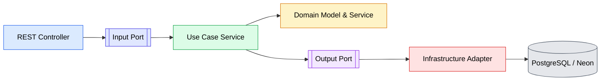
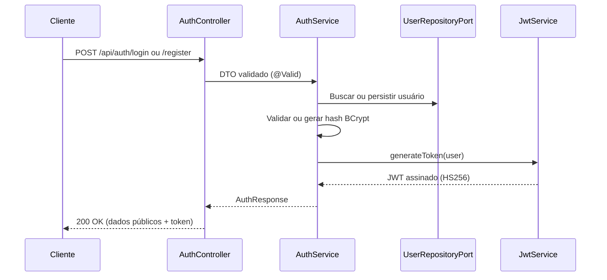

# 🎬 GitCine — Contexto Técnico e Arquitetura do Backend

Documento atualizado em **23/11/2026** com o estado real da refatoração, decisões arquiteturais e checklist de entrega.

---

## 📌 Visão Geral

O **GitCine** é a refatoração completa do backend legado DSMovie para uma arquitetura desacoplada, segura e orientada ao domínio, utilizando **PostgreSQL (Neon)** como banco gerenciado em nuvem.

| Tecnologia | Versão / Detalhe | Situação |
| :--- | :--- | :--- |
| **Java** | 25 | ✅ Configurado e em uso |
| **Spring Boot** | 4.1.2 | ✅ Configurado |
| **Spring Web & Validation** | Jakarta Validation + Jackson strict | ✅ Implementado e validado |
| **Spring Data JPA** | Hibernate (`ddl-auto: validate`) | ✅ Implementado e validado no Neon |
| **Spring Security + JJWT** | 0.12.6 (Stateless Bearer JWT) | ✅ Implementado e validado |
| **Spring Mail** | Envio SMTP (`@PostConstruct` fail-fast) | ✅ Implementado e validado |
| **PostgreSQL / Neon** | Banco em nuvem via variáveis de ambiente | ✅ Validado em execução real |
| **SpringDoc / OpenAPI** | 2.8.0 (ativo em `dev`, desativado em `prod`) | ✅ Configurado |
| **JUnit 5 + Cucumber + JaCoCo** | 7.20.1 / 0.8.14 | ✅ Implementado |
| **Testcontainers & ArchUnit** | 1.20.4 / 1.3.0 | ⏳ Dependências prontas, testes pendentes |

---

## 🧱 Arquitetura Hexagonal (Ports & Adapters)



### Mapa de Componentes Implementados

```text
com.dsmovie
├── domain
│   ├── model/         Movie, User (com enum Role), Rating, RatingId
│   ├── service/       MovieRatingCalculator, RatingDomainService
│   ├── validation/    RatingValidator
│   └── exception/     DomainException, AuthenticationException, DadosInvalidosException,
│                      DuplicateRatingException, InvalidRatingException,
│                      MovieNotFoundException, UserNotFoundException
├── application
│   ├── dto/           AuthResponse, LoginRequest, RegisterRequest, CreateMovieRequest,
│   │                  MovieListResponse, MovieResponse, MovieProposalRequest,
│   │                  RatingRequest, RatingResponse
│   ├── port/in/       AuthUseCase, CreateMovieUseCase, GetMovieUseCase,
│   │                  SaveRatingUseCase, SendMovieProposalUseCase
│   ├── port/out/      AuthenticationTokenPort, MovieRepositoryPort,
│   │                  RatingRepositoryPort, SendMovieProposalPort, UserRepositoryPort
│   └── useCase/       AuthService, MovieService, RatingService, MovieProposalService
└── infrastructure
    ├── config/        ApplicationConfig, SecurityConfig, OpenApiConfig
    ├── exception/     GlobalExceptionHandler (ApiError + X-Request-Id)
    ├── persistence/
    │   ├── entity/    MovieEntity, UserEntity, RoleEntity, RatingEntity, RatingIdEntity
    │   ├── repository/MovieJpaRepository, UserJpaRepository, RoleJpaRepository, RatingJpaRepository
    │   └── adapter/   MoviePersistenceAdapter, UserPersistenceAdapter,
    │                  RatingPersistenceAdapter, SmtpMovieProposalAdapter
    ├── rest/          AuthController, MovieController, AdminMovieController,
    │                  RatingController, MovieProposalController
    └── security/      JwtService, JwtAuthenticationFilter
```

> O pacote legado `com.devsuperior.dsmovie` e a dependência H2 foram totalmente removidos.

---

## 🔐 Autenticação JWT e Segurança

### Fluxo de Autenticação



### Estrutura do Token JWT

| Claim | Valor | Regra de Validação |
| :--- | :--- | :--- |
| `sub` (Subject) | `userId` (Long) | Identificador único usado nas operações autenticadas |
| `email` | E-mail normalizado | Em minúsculas e sem espaços |
| `name` | Nome de exibição | String não vazia |
| `role` | `USER` ou `ADMIN` | Mapeado para `ROLE_USER` / `ROLE_ADMIN` no Spring Security |
| `iss` (Issuer) | `gitcine-backend` | Validado obrigatoriamente na leitura do token |
| `exp` (Expiration) | `7200000` ms (2 horas) | Expirado retorna `401 Unauthorized` |

### Regras de Blindagem Implementadas

- **Validação de chave no startup (`@PostConstruct`):** `JwtService` impede a inicialização se `JWT_SECRET` estiver ausente, tiver menos de 32 bytes ou usar valor padrão em `prod`.
- **Prevenção contra escalação de privilégio:** O cadastro público (`RegisterRequest`) não aceita campo de role e atribui exclusivamente `ROLE_USER`.
- **Desserialização estrita:** `spring.jackson.deserialization.fail-on-unknown-properties: true` rejeita campos extras no JSON com `400 Bad Request`.
- **Rastreabilidade de erros:** `SecurityConfig` e `GlobalExceptionHandler` propagam ou geram `X-Request-Id` (`traceId`) em todas as respostas `401`, `403`, `400`, `404`, `409`, `422` e `500`.

---

## 👥 Matriz de Permissões (RBAC)

| Funcionalidade / Endpoint | Visitante (Público) | `ROLE_USER` | `ROLE_ADMIN` |
| :--- | :---: | :---: | :---: |
| `POST /api/auth/register` e `/login` | ✅ | ✅ | ✅ |
| `GET /api/movies` e `/api/movies/{id}` | ✅ | ✅ | ✅ |
| `GET /actuator/health` | ✅ | ✅ | ✅ |
| `POST /api/ratings` | ❌ (`401`) | ✅ | ✅ |
| `POST /api/movie-requests` | ❌ (`401`) | ✅ | ✅ |
| `POST /api/admin/movies` | ❌ (`401`) | ❌ (`403`) | ✅ |

---

## ⭐ Fluxo de Avaliação e Consistência de Dados

```mermaid
sequenceDiagram
    participant C as Cliente
    participant F as JwtAuthenticationFilter
    participant R as RatingController
    participant S as RatingService
    participant RP as RatingRepositoryPort
    participant MP as MovieRepositoryPort

    C->>F: POST /api/ratings (Bearer JWT)
    F-->>R: @AuthenticationPrincipal Long userId
    R->>S: save(userId, RatingRequest)